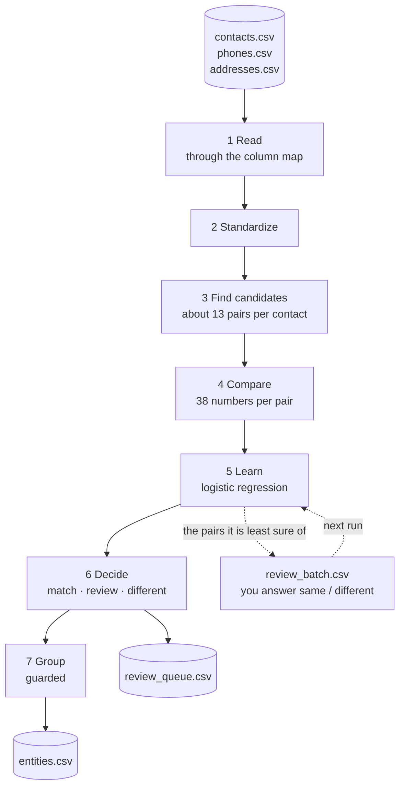
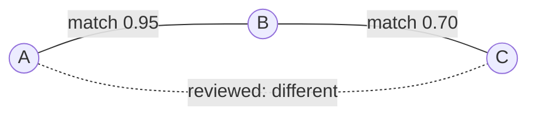
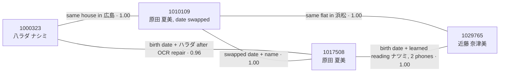
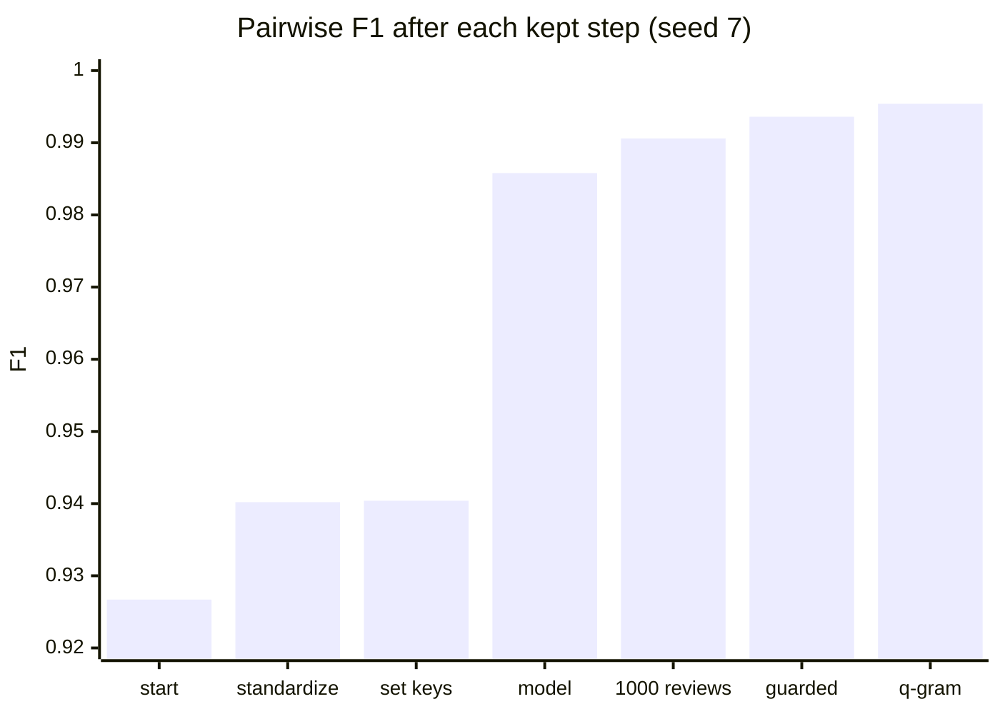
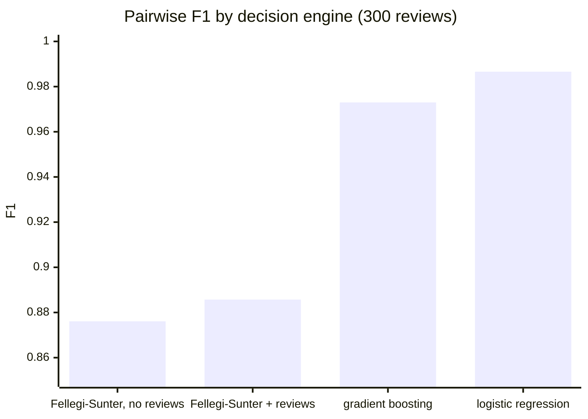
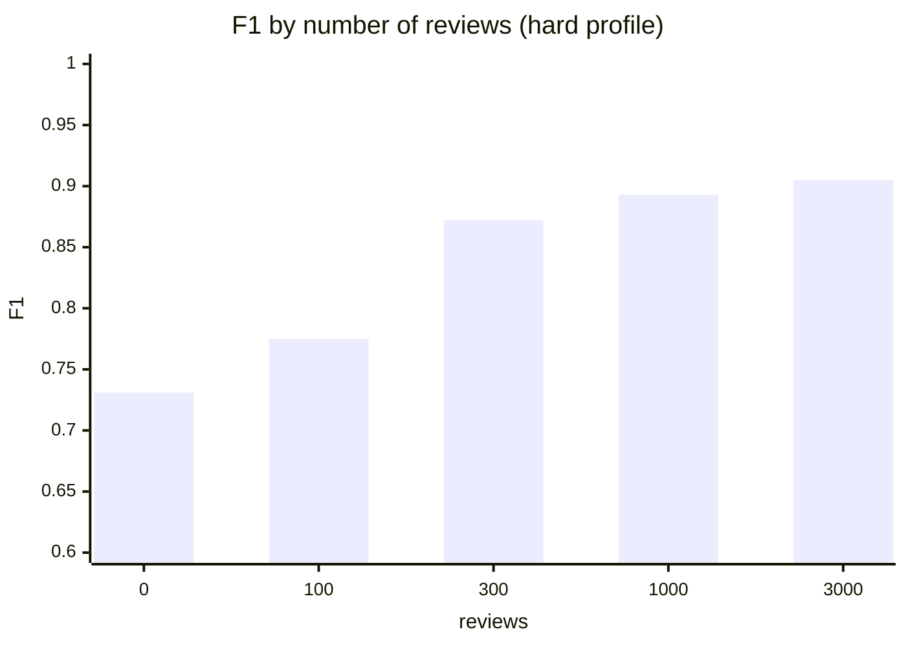
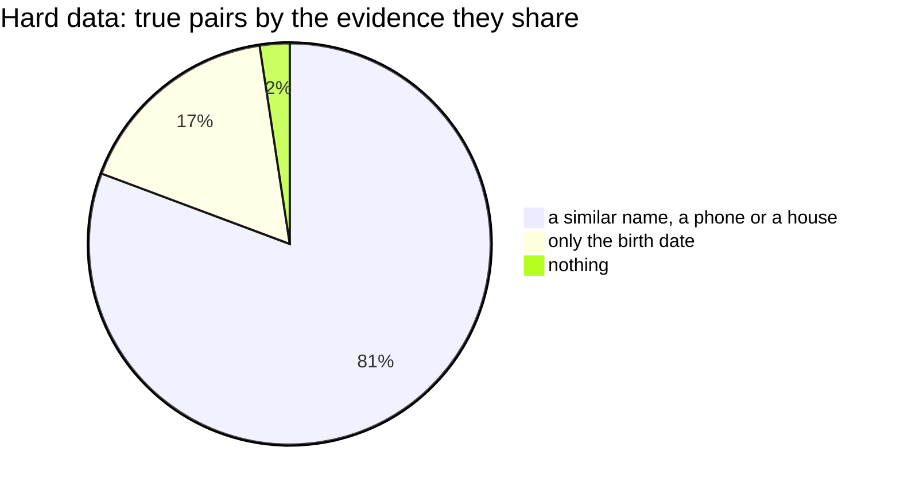

# How it works

**The problem.** In a CRM, one person often turns up as several contacts. They registered at
different times, through different channels, and different staff typed them in:
- names change at marriage, and people move;
- a clerk picks the wrong kanji for a name heard on the phone, or guesses its reading;
- OCR misreads the kana on a paper form;
- some fields are simply left blank.

Nayose (名寄せ) gives every contact an entity id; contacts of the same person or company share it.

**The hard part** is not finding contacts that look alike. It is two kinds of near-miss:
- people who share a lot without being the same: a family shares a landline and an address, and strangers can share a common name and a birth date;
- the same person who shares almost nothing: a maiden name, an old address, no phone.

## 1. Read

The program reads three CSV files joined on the contact key: contacts, phones (many per contact) and
addresses (many per contact).
- **The column map** (`config.yaml`, written by `init`) says which column holds what: the key (one or more columns), the names in kanji, kana and romaji, the birth date and its format, gender codes, the person/company flag, and the phone and address columns.
- **Encodings:** UTF-8 and Shift_JIS are both read.
- **Required fields:** only the key, the birth date and one name are required. Any other field can be blank.

## 2. Standardize

*Targets: the same value written differently.* Each fix is kept only if it measurably helps (see
[what each method adds](#what-each-method-adds)).

| What | How | Example |
|---|---|---|
| Kanji | Full-width forms and spaces removed; variant kanji folded | 髙橋 → 高橋, 﨑 → 崎, 邊 → 辺 |
| Kana | Hiragana to katakana and half-width to full-width; small kana to large (old systems cannot store them); ヅ/ヂ → ズ/ジ; long vowels folded | おおの, ｵｵﾉ, オーノ → オノ |
| An unvoiced key | Dakuten dropped, so a clerk's guessed reading still meets. A name written with ヅ/ヂ gets a second key, unvoiced as written (ツ/チ, where the first gives ス/シ). | ヤマザキ and ヤマサキ meet; ナカヅカ meets both ナカズカ and ナカツカ; マツダ and マスダ stay apart |
| Kana OCR repair | Kanji that OCR read into kana fields become kana again | 八ラダ → ハラダ |
| Misplaced kana | Kana typed in the kanji field moves to the kana field | |
| Phones | Digits only; +81 → 0; a lost leading 0 restored; placeholders (000…) and wrong lengths dropped | 70(3026)1290 → 07030261290 |
| Addresses | Matched against a town registry (`reference/towns.tsv`: 116,185 Japan Post towns, old names mapped to current ones), then kanji numbers → digits and 丁目/番地/号 → hyphens. Each address gives a **locality** (the town), a **house** (town and block number) and a **unit** (house and room). | 浜松市中区鍛冶町　１８４９ パークハイム 505号室 → town 浜松市中央区鍛冶町, house …\|1849, unit …\|1849\|505 |
| Readings learned from your data | When at least 2 contacts give a kanji name with its kana and at least 60% of them agree, that reading fills the kana of contacts that have only the kanji. Kanji-only and kana-only contacts then meet. | 奈津美 → ナツミ |
| A whole name in one field | Split after a surname your data knows | 山田花子 in the surname field → 山田 / 花子 |
| Companies | 御中, departments and addressees removed. The **name core** is the name without its legal form (株式会社, (株), ㈱, …) or branch (東京支店, 営業所, …), with loanword spellings folded. | 株式会社サンプル 東京支店 御中 → サンプル |
| Sole proprietors | A shop's base name becomes an alias surname of its owner | 藤江不動産 → alias 藤江 |

## 3. Find candidates

*Targets: comparing every pair is too slow (10,000 contacts make 50 million pairs), but a true
pair that is never compared can never be merged.* Four passes find the pairs worth comparing. On the
hard test data they find about 13 per contact (66,000 pairs).

| Pass | Pairs contacts that share | What it catches |
|---|---|---|
| exact | the birth date with the full name (kana or kanji), with the given name, or with the surname (or an alias); the birth date with day and month swapped; the unvoiced full kana name alone; for contacts with no birth date, the full name | a typo in one field; married women (their given name and birth date stay); swapped dates |
| shared | any phone, any house | a name changed at marriage, or garbled; a move |
| locality | the birth date and a town | contacts with no usable name |
| similar | names alike in 2-character pieces (TF-IDF cosine ≥ 0.5, the 10 nearest) | OCR and typos that break every exact key |

**Oversized groups are dropped:** more than 50 contacts on one key, or more than 20 on a phone,
house or town. A switchboard number or a care home's address shared by hundreds of contacts says
nothing about who is who.

## 4. Compare

*Targets: turning "how alike" into numbers a model can weigh.* Each pair gets 38 numbers:

| Group | The numbers |
|---|---|
| Names | Jaro–Winkler similarity of the full name, surname and given name (kana and kanji); exact agreement; first and last name swapped; how rare the shared name is |
| Birth date | exact; day and month swapped; how many digits differ; years apart (at most 50, so a mistyped year like 1067 is no outlier); how many contacts share it (at 100,000 contacts a birth date is far from unique) |
| Phones and houses | how many are shared, and how common the shared value is (a family landline versus a switchboard) |
| Addresses | best text similarity, same town, same room |
| Companies | both companies; one a company and one a person; the person/company flag; name-core similarity and equality |
| Other | gender; which fields are blank; kana filled from learned readings |

**The text similarity used:**
- **Comparing two names or addresses:** Jaro–Winkler. It counts the characters two strings share
  within a small window, discounts transposed ones, and gives extra weight to a shared beginning.
  It suits short strings such as names, where a typo or a dropped character should cost little.
  It runs on the standardized kana and kanji, so variant kanji, kana width and long vowels are
  already folded.
- **Finding similar names among all contacts:** TF-IDF over 2-character pieces with cosine
  similarity. Each name becomes its set of 2-character pieces, rare pieces weigh more, and every
  contact's 10 nearest names above 0.5 become candidates. This is a sparse matrix product (scipy).
- **Not used:** dense embeddings (ruri-v3) and a cross-encoder. Both were tried and dropped; see
  [what was tried and dropped](#what-was-tried-and-dropped).

## 5. Learn from your reviews

*Targets: how much each piece of evidence counts depends on your data.* A shared phone means more
in a list of individuals than in a list of employees of three companies. Weights set by hand, or
tuned on test data, would not fit.

- **Day 0, no reviews yet.** Nothing to learn from, so pairs are scored by an unsupervised Fellegi–Sunter model (EM over agreement levels). It is weak (F1 0.73 on the hard test data), and its job is to choose the first pairs to ask you about.
- **With reviews.** A logistic regression is trained on every pair you reviewed. It uses L2 regularisation (C = 1) on standardized features, with Newton's method in numpy (the same optimum as scikit-learn's default). Each run retrains it on all reviews so far.
- **Active learning.** Each batch asks about the pairs the model is least sure of, the ones closest to 50/50. 300 reviews chosen this way beat 1,000 chosen at random.
- **Review audit.** For each review, a model trained without it (5-fold, out of fold) predicts the answer. When the two strongly disagree (by more than 0.7), the pair is asked again: people make mistakes, and one wrong "same" can join two people.

## 6. Decide

1. Your review always wins.
2. Otherwise the score decides:
   - from `--match-at` (0.5) up: a **match**;
   - from `--review-from` (0.1) up to `--match-at`: **review** (into `review_queue.csv`);
   - below `--review-from`: **different**.

`--corroboration` is a precision-first policy: name and birth date alone never merge, and a match
also needs a shared phone, house, town or alias; the rest goes to review.

## 7. Group (guarded clustering)

*Targets: chains.* If A matches B and B matches C, plain grouping (connected components) puts A
and C together even when you said they are different people. Guarded clustering:
- applies matches strongest first (your reviews, then the highest score);
- refuses any merge that would put two contacts decided different into one group;
- refuses any merge that would make a group larger than `--max-size` (12).

Here A–B merges first. B–C is then refused because it would join A and C, so B–C goes to review.

## 8. Publish

`entities.csv` gives every contact its entity id: the lowest contact key in its group. The id stays
the same from run to run as long as that contact does.

## An example from the test data

One person, four contacts (hard profile, seed 7):

| CONT_ID | Name | Kana | Birth date | Phones | Addresses | What went wrong |
|---|---|---|---|---|---|---|
| 1000323 | | 八ラダ ナシミ | 1992-04-03 | | 広島県広島市中区紙屋町２丁目３０番６号 | OCR (八 for ハ, シ for ツ), no kanji |
| 1010109 | 原田 夏美 | ハラダ ナツミ | 1992-**03-04** | | 広島市中区紙屋町2ー30ー6, 静岡県浜松市中区鍛冶町 1849番地　パークハイム505 and 2 more | day and month swapped |
| 1017508 | 原田 夏美 | ハラダ ナツミ | 1992-04-03 | 070-3026-1290, 080(9697)6693 and 5 more | | none |
| 1029765 | **近藤 奈津美** | | 1992-04-03 | 70(3026)1290, 080(9697)6693 | 浜松市中区鍛冶町　１８４９ パークハイム 505号室 | her maiden name, other kanji for ナツミ, no kana, a lost leading 0, an old ward name |

All four get entity id 1000323. No single key finds them all. The links use a shared house, a
kana name after OCR repair, a swapped birth date, a learned reading and a repaired phone number.

---

# What each method adds

**How a method earned its place.**
- It was kept only if it raised the pairwise F1 on both test datasets (seeds 7 and 11), by more than run-to-run noise.
- Every dropped method was tried again on the final pipeline.
- The reviewer is simulated from the answer key.
- The research code is in the studio repo ([RESULTS.md](https://github.com/mvsbm/agent-workflow-studio/blob/9845b93/research/contacts_er/RESULTS.md)).
- This package's code reproduced the research F1 to within 0.0005, before the [fixes since the research](#what-each-method-adds) listed at the end of this section.

**F1 after each kept step** (base test data, seed 7, 10,000 contacts). The steps, in order: standardize, shared phone
and house candidates (set keys), the model on 300 reviews, 1,000 reviews, guarded clustering, similar-name
candidates (q-gram):

| Method | What it targets | What it improved (seed 7 / seed 11) | Why this one |
|---|---|---|---|
| Standardization | the same value written differently | F1 +0.0135 / +0.0106; missed pairs 1,017 → 820 / 959 → 803 | cheap, and every later step depends on it |
| Shared phone and house candidates | name changed at marriage, moves | removing them costs −0.0128 / −0.0156 F1 (+210 / +241 missed pairs) | the largest gain after the model; a family shares them too, so they only make candidates and the model decides |
| Similar names (q-gram TF-IDF) | OCR and typos that break exact keys | +0.0018 / +0.0008 | sparse and fast; it beat dense embeddings (see below) |
| Logistic regression on reviews | how much each piece of evidence counts in *your* data | +0.0454 / +0.0484 over fixed rules; replacing it with rules costs −0.0985 | it beat Fellegi–Sunter and gradient boosting with the same reviews, and stays stable with few labels |
| Active learning | review effort | 300 active reviews: F1 0.9893 / 0.9898; 300 random: 0.9799 / 0.9759; 1,000 random: 0.9865 / 0.9869 | about 3× as label-efficient as random |
| 1,000 reviews instead of 300 | false merges | +0.0048 / +0.0050 | |
| Guarded clustering | chains that join strangers | +0.0030 / +0.0036; false merges 107 → 56 / 83 → 26 | it respects "different" decisions, which connected components cannot |

Methods added for very dirty data, companies and shops (seed 7 / seed 11; hard data unless the row
says otherwise):

| Method | What it targets | What it improved |
|---|---|---|
| Kana OCR repair | kanji read into kana fields | +0.0077 / +0.0039 |
| Readings learned from the data | kanji-only contacts versus kana-only ones | +0.0103 / +0.0143 (missed pairs −200 / −239) |
| Splitting a whole name typed into one field | 山田花子 in the surname field | +0.0054 / +0.0012 |
| Birth date + town candidates | contacts with no usable name | +0.0027 / +0.0023 |
| How many contacts share the birth date (a feature) | false merges in large lists | at 100,000 contacts, false merges 11,953 → 6,750 (F1 0.8158 → 0.8431) |
| Review audit | a reviewer who is wrong 5% of the time | F1 0.9801 → 0.9902 (36 of 44 wrong reviews caught for 72 extra questions); hard 0.8735 → 0.8805 |
| A shop's base name as an alias | sole proprietors (藤江不動産 ↔ 藤江 太郎) | lifelike hard data: shop-to-owner links 71 → 82; F1 +0.0023 / +0.0027 |
| Company field cleaning and the name core | 御中, departments, (株)/㈱, branches | company hard data: company false merges 161 → 52 (seed 7) |
| Same name core (a feature) | the same company written differently | company hard data: missed company pairs 134 → 73 / 102 → 32 |

**Taking one method out of the final pipeline** (every removal must cost F1 on both seeds):

| Removed | Seed 7 ΔF1 | Seed 11 ΔF1 | What goes wrong |
|---|---|---|---|
| the model (back to rules) | −0.0985 | −0.0979 | 1,382 / 1,328 more true pairs missed |
| shared phone and house candidates | −0.0128 | −0.0156 | 210 / 241 more missed (married, moved) |
| 1,000 → 300 reviews | −0.0065 | −0.0064 | 101 / 94 more false merges |
| standardization | −0.0053 | −0.0054 | 55 / 81 more missed |
| guarded → plain grouping | −0.0047 | −0.0031 | 76 / 49 more false merges |
| similar-name candidates | −0.0018 | −0.0008 | 26 / 1 more false merges, 3 / 12 more missed |

**Decision engines with the same candidates and the same 300 reviews** (mean of seeds 7 and 11):

| Engine | Seed 7 | Seed 11 |
|---|---|---|
| Fellegi–Sunter (EM, no reviews) | 0.8811 | 0.8710 |
| Fellegi–Sunter with 300 reviews | 0.8902 | 0.8811 |
| Gradient boosting, 300 reviews | 0.9851 | **0.9609** (unstable) |
| **Logistic regression, 300 reviews** | **0.9858** | **0.9874** |

**This program, measured end to end** with `{name} benchmark --profile hard --budget N`
(10,422 contacts of 5,731 people):

| Reviews | F1 | Precision | Recall |
|---|---|---|---|
| 0 (day 0) | 0.731 | 0.679 | 0.791 |
| 100 | 0.775 | 0.886 | 0.689 |
| 300 | 0.872 | 0.936 | 0.815 |
| 1,000 | 0.893 | 0.964 | 0.831 |
| 3,000 | 0.905 | 0.992 | 0.832 |

Reviews mostly buy precision (fewer wrong merges). Recall stops near 0.83 because about 19% of the
true pairs share nothing but a birth date ([limits](#limits)).

On the company-heavy synthetic data (`company_hard`: names, towns and companies drawn from public lists; it needs the download):
- no reviews: F1 0.54 (precision 0.85, recall 0.39);
- 1,000 reviews: F1 0.96 (precision 0.98, recall 0.93; 0.957 to 0.958 over seeds 7, 11 and 3).

The order in which pairs come up for review moves F1 by about ±0.003 on company data and ±0.001
on the hard data (five review orders, the same data).

**Fixes since the research.** Each was measured the same way: the same candidates and features,
with five review orders.

| Fix | What went wrong | Effect |
|---|---|---|
| Years apart is capped at 50 | A typo in the first digit of a birth year (1967 typed as 1067; about 3 contacts in 1,000) puts a true pair 900 years apart. When such a pair was among the reviews, the model learned that a huge gap means "same", and about 400 strangers merged. | hard seed 7: F1 0.876 ± 0.023 → 0.893 ± 0.000 (two of the five review orders had fallen to 0.851); hard seed 11: 0.887 → 0.889; company_hard: 0.960 → 0.960 and 0.959 → 0.959 |
| A second unvoiced key for names written with ヅ/ヂ | ナカツカ, a clerk's unvoiced guess, never met ナカヅカ | ナカヅカ now meets both ナカズカ and ナカツカ. F1 is unchanged within the noise, since it touches a few dozen contacts in 10,000. |
| The similar-name search no longer depends on Python's hash order | The same input gave slightly different candidates from run to run, so a pair you had reviewed could drop out of the next run | the same input now gives the same result |

# What was tried and dropped

| Method | What it was for | What happened | Why it was dropped |
|---|---|---|---|
| Dense embedding candidates (ruri-v3-30m, nearest neighbours) | names too garbled for keys | 10,000 contacts: +1.1% candidate recall, but F1 0.9927 / 0.9934 against 0.9954 / 0.9968 without. On hard data at 10,000 it looked like +0.03; at 100,000 it was 0.8402 against 0.8417, and 4× slower (246 s against 61 s). On companies: −0.0022 on company hard 11, with 1.8× the candidates. | The extra pairs share little more than a birth date. At 10,000 contacts that is nearly unique; at 100,000 it is not. The gain was a small-population artifact. |
| Cross-encoder reranker (ruri-v3-reranker-310m) on uncertain pairs | hard pairs | F1 unchanged everywhere: only 66 pairs were left uncertain | nothing left for it to fix |
| Fellegi–Sunter as the decision engine | matching without labels | 0.881 / 0.871 without reviews; 0.890 / 0.881 with 300 reviews, against 0.986 / 0.987 for logistic regression | Households break its independence assumption: family members agree on surname, phone and address together. It is still used on day 0, only to pick the first questions. |
| Fellegi–Sunter with u from random pairs (Splink-style) | a better unlabelled baseline | collapsed (F1 0.34) | a fault of this implementation's EM, not proof against Splink |
| Gradient boosting | a stronger model | unstable at 300 reviews (0.9609 on seed 11); no better at 1,000 | too few labels for it |
| Weak labels from rules (no review) | skipping the reviews | 0.9750 on seed 7, 0.8836 on seed 11 | unstable |
| Hand-set rules (points per agreement) | day-0 decisions | the model beats them by 0.098 F1 | a person cannot guess the weights |
| Plain grouping (connected components) | grouping | guarded clustering beats it by 0.003 to 0.005 | chains join strangers |
| Cleaning person fields (様/殿, notes, gender codes, phone notes) | wild CRM dirt | −0.0154 / +0.0027 on hard data | inconsistent |
| Placeholder birth dates found by frequency | 1900-01-01 and the like | −0.0021 / +0.0010 on hard data; +0.0108 on wild | it helps only where placeholders dominate |
| Company name core as a candidate key | companies | ±0.0009, within noise | every missed company pair was already a candidate; the model scored it apart |
| A legal form meaning "never a person" (cannot-link) | keeping people and companies apart | F1 fell on all four lifelike datasets (seed 7: 0.9876 against 0.9912) | A department in FIRST_NAME makes a company contact look like a person, so it split companies. The pipeline never merged a person with a company anyway. |
| Trusting the person/company flag for that | the same | lifelike seed 7: 0.9682 | wrong flags split shops from their owners (71 → 13 linked) |
| Extra company features (same core and founding date; shared phone but different core) | the last company errors | +0.0002 to +0.0014, within noise over 5 seeds | |
| Gender and name-frequency features | | no effect when removed | still computed (harmless to a regularised model); nothing depends on them |
| The corroboration rule as the default | fewer wrong merges | 87% fewer false merges, but at 100,000 hard contacts recall fell 0.799 → 0.479 and 34,636 pairs went to review | moves the work to people; kept as an option (`--corroboration`) |

**Where to set the threshold is a business choice** (hard data, 100,000 contacts, 10,000 reviews):

| `--match-at` | Precision | Recall | False merges | Missed pairs |
|---|---|---|---|---|
| 0.5 | 0.935 | 0.791 | 4,672 | 17,683 |
| 0.7 | 0.936 | 0.788 | 4,561 | 17,955 |
| 0.85 | 0.947 | 0.765 | 3,658 | 19,930 |
| 0.95 | 0.963 | 0.726 | 2,344 | 23,244 |

# Limits

**Some pairs cannot be linked safely by any method.** On the hard data, true pairs by the evidence
they share:

At 1,000,000 contacts about 34 people share each birth date. A pair that shares only a birth date
cannot be merged without merging strangers, so recall on hard data stays near 0.81 to 0.83.

What remains wrong after 1,000 reviews:
- **False merges:**
  - look-alike strangers with the same name and birth date;
  - an absorbed company with its successor, which took over its phone number;
  - sibling group companies on one switchboard.

  Only more evidence separates them, such as a corporate number, a second identifier or a person's review.
- **Missed pairs:**
  - first and last name swapped (recall 0.91 to 0.93);
  - day and month swapped (0.93 to 0.98);
  - contacts with no name in either script;
  - company contacts that stack several kinds of dirt.

**What has not been proven:**
- The test data comes from our own generator, and your own data will have mess we did not imagine. The decisive check is a labelled sample of your own data, matched on your own machine; nothing leaves it.
- The largest measured run is 100,000 contacts. 1,000,000 has not been run.

## Research consulted

- Blocking: Papadakis et al., blocking surveys (arXiv:1905.06167, arXiv:2202.12521); Thirumuruganathan et al., DeepBlocker (PVLDB 2021); Zeakis et al. (arXiv:2304.12329).
- Fellegi–Sunter and term frequency: the Splink documentation.
- Active learning: Kasai et al. (ACL 2019).
- Learned and LLM matching: Ditto (VLDB 2021); Peeters et al. (EDBT 2025).
- Benchmarks and metrics: OpenSanctions Pairs (arXiv:2603.11051); Menestrina et al. (PVLDB 2010).
- Japanese models: the ruri-v3 model cards.
- Address parsing against a town registry: Geolonia normalize-japanese-addresses; Digital Agency abr-geocoder.
