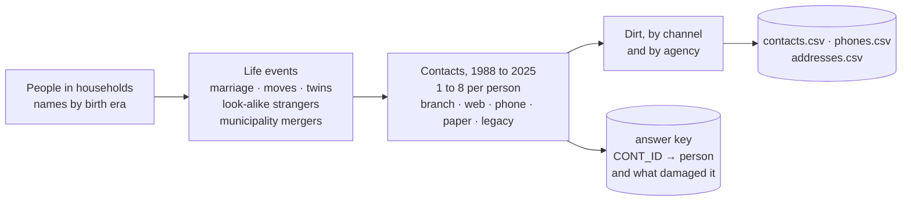
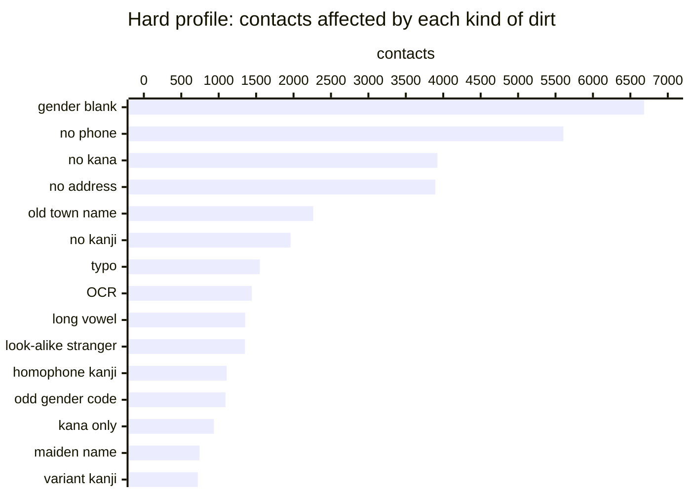

# How the synthetic data is made

There is no public Japanese CRM with an answer key, and customer data must not leave its machine. So
the tests use synthetic contacts in the shape of a CRM export, generated together with the
answer (which contacts are one person). `{name} generate` writes them;
`{name} benchmark` generates, matches and scores in one go. The same profile, size and
seed always give the same data. The generator uses only the standard library. Every contact is
synthetic: no customer data is used or shipped.

**1. People.**
- About 2.4 people per household, sized so the contacts come to the number asked for.
- Surnames are drawn from common surnames with their readings, including alternative readings and true variant kanji (髙, 﨑), or composed from parts (山 + 田). Given names follow the birth era (before 1955, 1955–1984, from 1985).
- 2.5% are foreign residents.

**2. Life events.**
- Daughters who marry take their husband's surname; 4% of husbands take the wife's.
- Children leave home and move.
- 4% of births are twins, and 2% of sons are named after their father.
- Look-alike strangers are added: the same name as an existing customer, and in 35% of cases the same birth date too.
- Addresses go through actual municipality mergers (田無市 became 西東京市 in 2001), so old town names appear.

**3. Contacts.**
- Each person is registered 1 to 8 times between 1988 and 2025: 55% once, 25% twice, the rest more.
- Each registration comes through one channel (branch, web, phone, paper or legacy) and one agency. Each agency has its own sloppiness, from 0.4× to 2.8×.
- A contact holds the name as it was at that date, so a maiden name appears before the marriage. Romaji is generated from the kana.
- Phones and addresses number 1 to 23 per contact (a Pareto distribution).
- Values are shared on purpose: a household's landline and address, a workplace switchboard, a care home's address.
- Contact ids are shuffled, so they say nothing about who is who.

**4. Dirt**, the ways CRM data goes bad in practice:
- variant kanji, and homophone kanji (a name heard on the phone);
- guessed readings, kana width, lost small kana and long-vowel spellings;
- OCR misreads and typos;
- birth dates mistyped or with day and month swapped;
- phone formats (+81, brackets, a lost leading 0);
- address notations (kanji numbers, 丁目/番地, old town names, partial addresses);
- blank fields;
- gender blank or wrong, and the person/company flag wrong.

The dirt in the hard profile, by contacts affected (10,422 contacts):

**5. Companies and sole proprietors** (the `lifelike` and `company` profiles).
- Company names, furigana and head offices are drawn from the National Tax Agency's public registry. The contacts themselves (who registered, when, with which phone) are synthetic.
- They come with the registry's own events:
  - renamed (6% of companies);
  - head office moved (6%);
  - absorbed by a merger (6%; 30% of successors take over the phone number);
  - same-name strangers;
  - group companies sharing a building and a switchboard.
- CRM staff add their own dirt:
  - the legal form written in full (50%), as (株) (22%) or as ㈱ (10%), or left out (18%);
  - branch names (25%) and 御中 (8%);
  - a department in FIRST_NAME (6%);
  - bank-transfer kana (8%);
  - the founding date, the registration date or nothing in BIRTH_DATE;
  - a FAX number in the phone field.
- 8% of adults aged 25 to 80 run a shop. About half of their later contacts are under the shop's name (藤江不動産), with the shop's phone, and the answer key says shop and owner are one entity.

**Profiles** (`--profile`):

| Profile | What it adds | Needs the download |
|---|---|---|
| `base` | the dirt above at normal rates | no |
| `dirty` | 2.5× every kind of dirt | no |
| `sparse` | 4× blank fields | no |
| `lookalike` | 5× look-alike strangers, a population heavy in common names | no |
| `wild` | CRM mess: 様/殿 and （旧姓 X） in name fields, the whole name in the surname field, romaji in the kanji field, four gender code styles, placeholder birth dates, extensions and two numbers in one phone field, 同上 and postal-code-only addresses | no |
| `hard` | all of the above at once | no |
| `lifelike`, `lifelike_hard` | names drawn by their frequency in public lists, with readings (Nemotron-Personas-Japan, UniDic, JMnedict), towns from Japan Post, 12% companies, 8% sole proprietors | yes |
| `company`, `company_hard` | 35% companies, with the registry's events and staff dirt | yes |

The answer key (`<name>_key/answer_key_contacts.csv`) gives every CONT_ID its true entity, and tags
naming how that contact was damaged. Scores are pairwise and B-cubed precision, recall and F1
against it.
